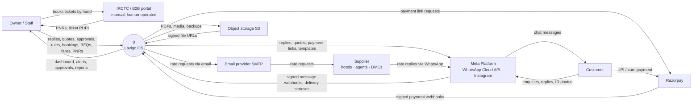
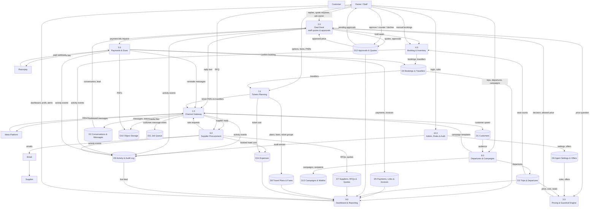
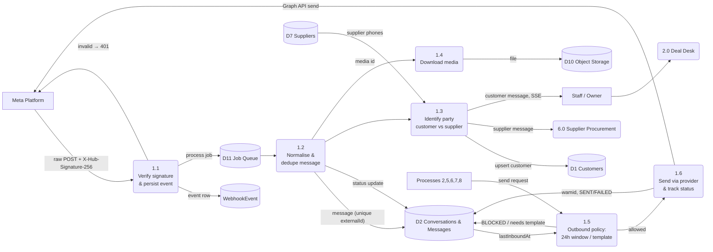
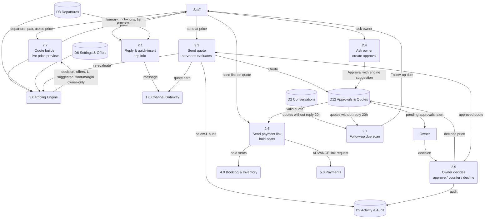
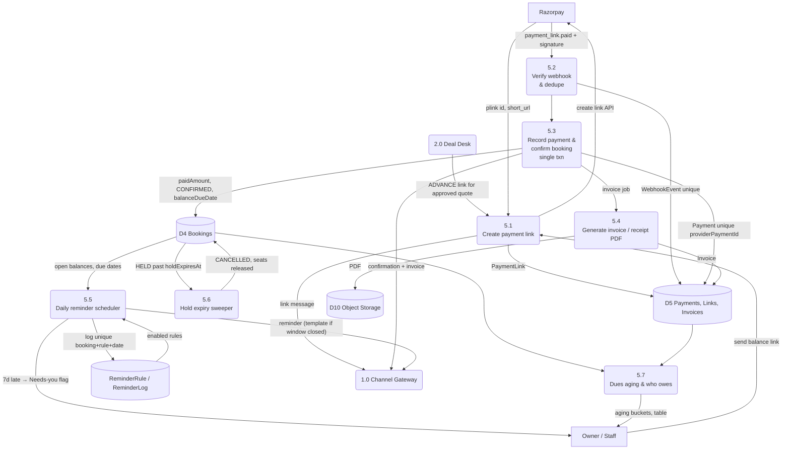
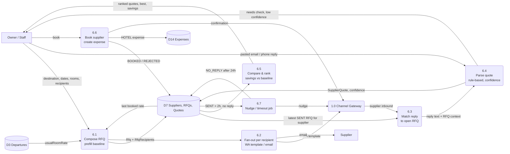
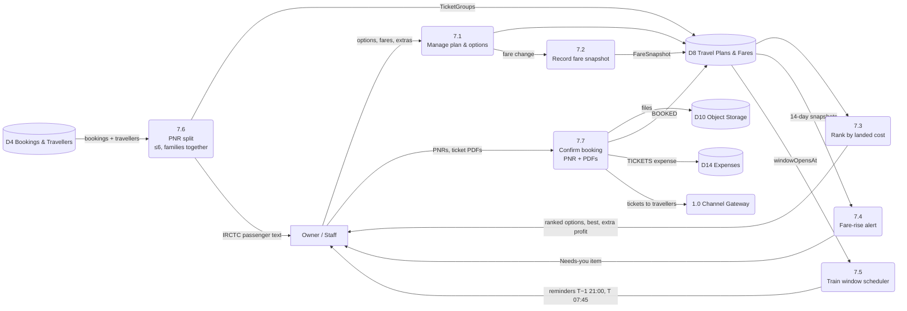
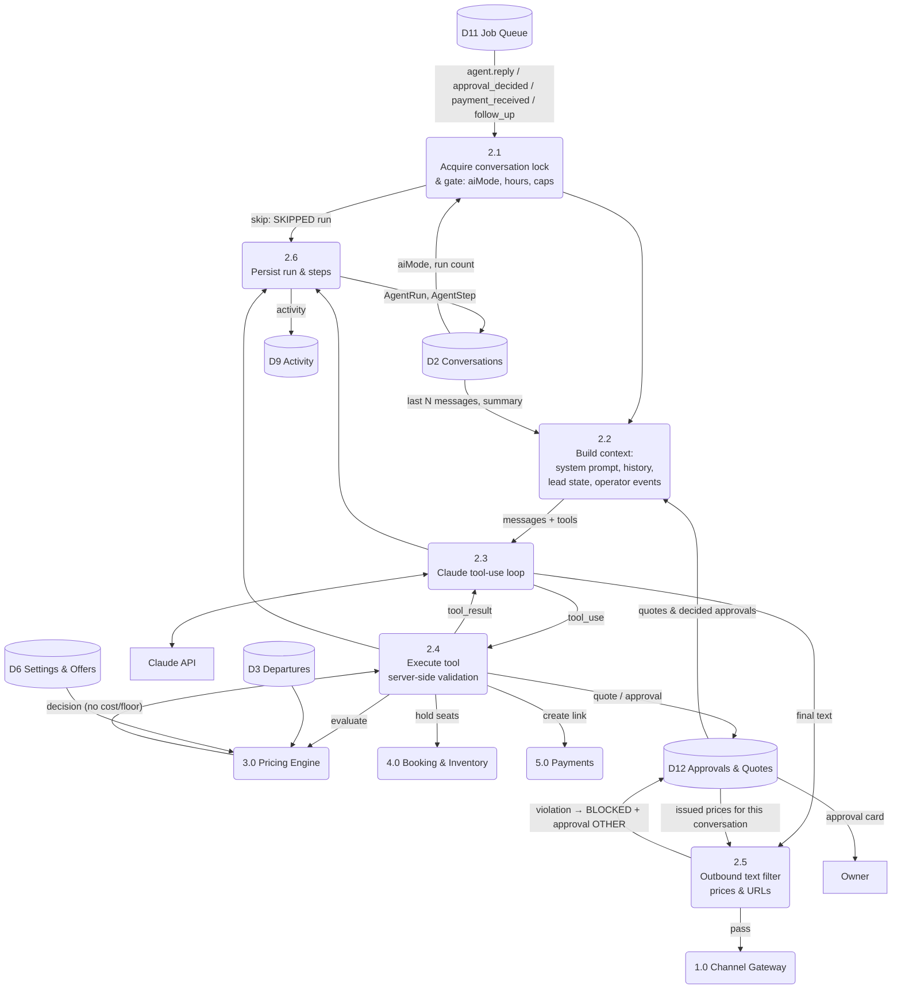

# Lavigo OS — Data Flow Diagrams

The diagrams use Mermaid, which GitHub renders natively. The notation follows Yourdon/DeMarco DFDs:

| Shape | Meaning |
|---|---|
| Rectangle | External entity (source or sink outside the system) |
| Rounded box `( )` with number | Process (transforms data) |
| Cylinder | Data store (`D#`) |
| Labelled arrow | Data flow (what moves, not control) |

Store numbering is shared across levels, so `D4 Bookings` is the same store everywhere.

**Release scope:** these diagrams show **v1** (no AI/LLM, per SRS §1.1). Process 2.0 is the staff-operated **Deal Desk**. The v2 AI agent and LLM flows are in the appendix at the end; in v2 the AI agent joins 2.0 as a second actor that calls the same functions.

---

## Level 0 — Context diagram

The whole system is one process. Everything else is outside it.

---

## Level 1 — Major processes

### Level 1 process dictionary

| # | Process | Inputs | Outputs | Stores |
|---|---|---|---|---|
| 1.0 | **Channel Gateway**: verifies, normalises and routes inbound messages; sends outbound with 24h-window and template policy | Meta webhooks, outbound requests from 2/5/6/7/8 | Normalised messages, SSE events, provider sends | D1, D2, D10, D11 |
| 2.0 | **Deal Desk**: staff replies, quote builder, ask-owner approvals, payment link from chat *(v2: the AI agent also drives it)* | Staff/owner actions, approval decisions, conversation state | Replies, quotes, approvals, held bookings, payment-link requests | D2, D12 |
| 3.0 | **Pricing & Guardrail Engine**: a pure function, the single source of price truth | Departure, pax, customer, rules, requested price | Decision, allowed price, suggested counter | reads D3, D6, D4 |
| 4.0 | **Booking & Inventory**: seat holds, booking lifecycle, travellers | Agent or staff booking requests, payment confirmations, hold expiry | Bookings, seat counts | D3, D4 |
| 5.0 | **Payments & Dues**: links, webhooks, invoices, reminders | Link requests, Razorpay webhooks, daily scheduler | Payments, invoices, reminders, confirmations | D4, D5, D10 |
| 6.0 | **Supplier Procurement**: RFQ fan-out, rule-based reply parsing, compare, book | Owner RFQ, supplier replies | Quotes, bookings, expenses | D7, D14 |
| 7.0 | **Tickets Planning**: landed-cost ranking, fare trend, booking window, PNR split | Options and fares entered by staff, travellers | Rankings, alerts, ticket groups | D8, D4, D14 |
| 8.0 | **Departures & Campaigns**: catalog, fill-seats audiences, sends, attribution | Owner input, customers, bookings | Departures, campaigns | D3, D13 |
| 9.0 | **Dashboard & Reporting**: KPIs, Needs-you, live feed, profit | All stores (read-only) | Views, SSE events | reads all |
| 10.0 | **Admin, Rules & Auth**: sessions, RBAC, settings, audit | Credentials, rule edits | Sessions, settings | D6, D9 |

---

## Level 2 — 1.0 Channel Gateway

## Level 2 — 2.0 Deal Desk (v1)

## Level 2 — 5.0 Payments & Dues

## Level 2 — 6.0 Supplier Procurement

## Level 2 — 7.0 Tickets Planning

---

## Appendix — v2 (deferred): Level 2 for the 2.0 AI Sales Agent

In v2, the Anthropic Claude API joins Level 0 as an external entity ("conversation context, tool results" out; "replies, tool calls" in). Process 2.0 gains this AI path. Its tools call the v1 Deal Desk functions (2.3, 2.4, 2.6). The `payment_received` trigger also resumes the agent.

