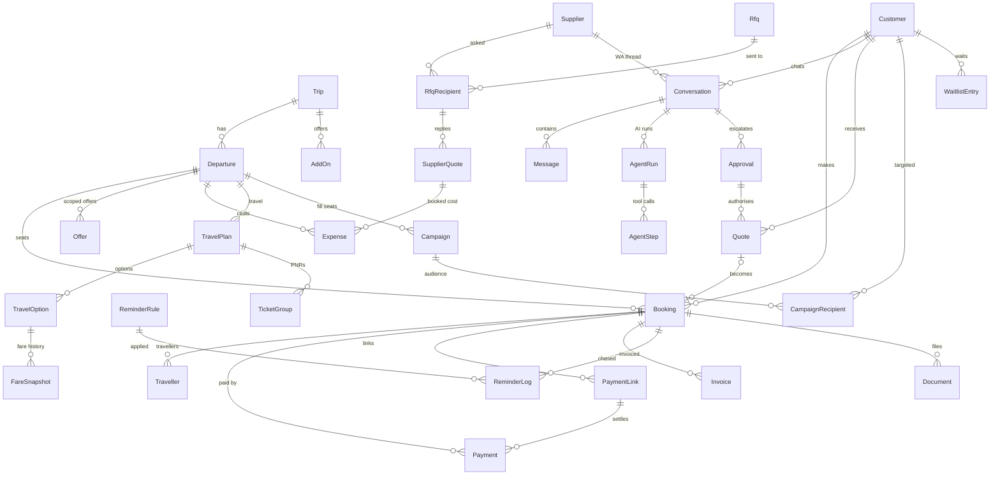
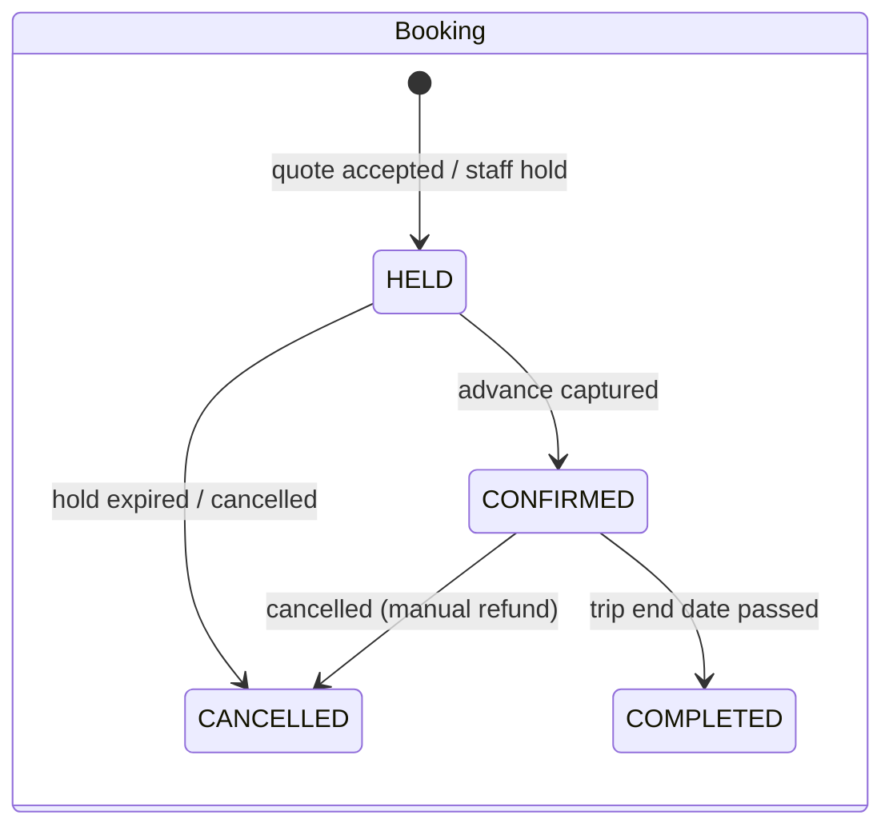
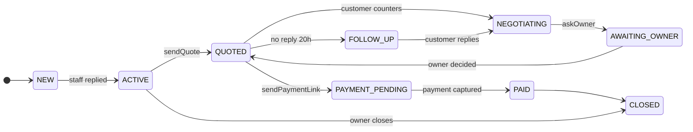

# Lavigo OS — Database Schema

The source of truth is `docs/design/schema.prisma`. It has been validated with `prisma validate` and has 37 models and 47 enums. In Phase 0 it is copied to `prisma/schema.prisma`. After that, **`prisma/schema.prisma` is the source of truth**, and changes go in as new migrations.

> **v1 note (no AI):** the AI-only parts of the schema are **kept but unused in v1**, so v2 needs no migration on core tables:
> - `AgentRun`, `AgentStep`, `Message.agentRunId`
> - `Conversation.aiMode`, `Conversation.summary`
> - the `AI` value of the `Author` enum
> - `AgentSettings` fields `freebieFirst`, `reply24x7`, `businessHours*`, `escalateComplaints`, `escalateRefunds`, `assistantName`
>
> v1 must not write to them. `AgentSettings` still holds the pricing rules (floor, staff discount = `soloDiscountPerPax`, advance %, due days, GST, charm ending, escalation group size). In v1, `Quote.createdBy` is `OWNER` (staff or owner), and `Approval` rows are created by staff "Ask owner".

## Conventions

| Rule | Why |
|---|---|
| Money is `Int` **paise** (`pricePerPax = 1399900` means ₹13,999) | No float rounding, and payment providers use paise. |
| Percentages are `Int` **basis points** (`floorMarginBps = 1700`) | Same reason. |
| Calendar dates are `@db.Date`, interpreted in Asia/Kolkata | A departure "on 28 Nov" must never shift a day because of UTC. |
| `paidAmount` on Booking is denormalised | Lists, dues and KPIs avoid N+1 queries. It is **only** written inside the payment transaction. |
| Seats sold is *derived* (Σ pax of HELD/CONFIRMED/COMPLETED) | No counter to drift. It is locked with `SELECT … FOR UPDATE` on the Departure row. |
| Unique keys double as idempotency keys | `Message.externalId`, `Payment.providerPaymentId`, `PaymentLink.providerLinkId`, `WebhookEvent(provider, externalId)`, `ReminderLog(booking, rule, date)`, `CampaignRecipient(campaign, customer)` |
| "Needs you" is **not a table** | It is a query composed from approvals, dues, RFQs, fares and departures, so it is never stale. |
| `AgentSettings` is a singleton row `id = 1` | Edited on the Pricing rules screen and read on every quote (and, in v2, every agent run). |

## Raw SQL the migration must add

Prisma can't express these, so they go in the first migration's `migration.sql`:

```sql
CREATE SEQUENCE IF NOT EXISTS booking_code_seq START WITH 24901;
-- usage: SELECT 'LVG-' || nextval('booking_code_seq')
CREATE EXTENSION IF NOT EXISTS pg_trgm;
CREATE INDEX IF NOT EXISTS customer_name_trgm ON "Customer" USING gin (name gin_trgm_ops);
CREATE INDEX IF NOT EXISTS booking_code_trgm ON "Booking" USING gin (code gin_trgm_ops);
```

The seed inserts demo bookings with explicit codes (`LVG-24817` … `LVG-24853`). New bookings come from the sequence, starting at `LVG-24901` as in the demo.

## Entity-relationship overview



## Model groups

| Group | Models | Notes |
|---|---|---|
| Identity | `User`, `AuditLog` | Roles OWNER/STAFF. `User.phone` receives approval alerts. |
| Customers | `Customer`, `WaitlistEntry` | Upserted by phone (WA) or IGSID (IG). `marketingOptIn` gates campaigns. |
| Catalog | `Trip`, `Departure`, `AddOn`, `Offer` | Price, cost and seats on Departure. Offers can be global (`departureId = null`) or departure-specific. |
| Rules | `AgentSettings` | Floor, staff discount (`soloDiscountPerPax`), offers toggles, advance %, due days, GST. AI-only fields are v2. |
| Conversations | `Conversation`, `Message`, (`AgentRun`, `AgentStep`: v2) | `@@unique([channel, externalThreadId])`. `lastInboundAt` drives the 24h window. A conversation belongs to a customer **or** a supplier. |
| Deals | `Approval`, `Quote` | The approval's `suggestedPricePerPax` comes from the engine. A quote is the only thing a booking can be created from in the AI flow. |
| Bookings | `Booking`, `Traveller`, `Document` | Status HELD → CONFIRMED → COMPLETED, or CANCELLED. CUSTOM bookings have no departure. |
| Payments | `Payment`, `PaymentLink`, `Invoice` | Razorpay ids are unique. Manual payments have `provider = MANUAL`. |
| Dues | `ReminderRule`, `ReminderLog` | Five seeded rules match the demo toggles. |
| Suppliers | `Supplier`, `Rfq`, `RfqRecipient`, `SupplierQuote` | Supplier phone is unique, which routes inbound WhatsApp to the RFQ parser. |
| Costs | `Expense` | Actual costs. Profit uses actual costs if any exist, else `costTotalPlanned`. |
| Tickets | `TravelPlan`, `TravelOption`, `FareSnapshot`, `TicketGroup` | `TicketGroup.passengers` is a JSON snapshot (≤ 6). |
| Campaigns | `Campaign`, `CampaignRecipient` | Attribution via `convertedBookingId`. |
| Messaging | `MessageTemplate` | Mirrors templates approved in Meta. |
| Infra | `WebhookEvent`, `ActivityEvent` | Dedupe and replay protection; the live feed. |

## State machines





## Seed data (`prisma/seed.ts`)

The seed must reproduce the demo exactly, so the client sees familiar data on Saturday. **Dates are computed relative to the seed run date**, so "25 days to go" stays true whenever it runs.

| What | Records |
|---|---|
| Users | Owner `owner@lavigo.local` (initials LK), staff `staff@lavigo.local`. Passwords come from env `SEED_OWNER_PASSWORD` / `SEED_STAFF_PASSWORD`, with a printed random default. |
| Departures | `NP-28N` Nepal (+25 days, 30 seats, ₹13,999 / cost ₹10,900, travel budget ₹2,600); `NT-05D` Netarhat (+32 days, 18 seats, ₹4,999 / ₹3,700); `DJ-19D` Darjeeling (+46 days, 24 seats, ₹11,499 / ₹8,900); `SK-09J` Sikkim (+67 days, 20 seats, ₹18,999 / ₹14,600, travel budget ₹2,200). Demo images are extracted to `public/images/departures/*.jpg`. |
| Bookings | The 8 demo bookings (Amit Kumar … Meera Jha) with the same pax, totals, paid amounts, sources and lateness (due dates set so that `late` = 6, 2, 14 days, etc.). Sold counts must match the demo: Nepal 21, Netarhat 12, Darjeeling 10, Sikkim 3. Add filler bookings with plausible Indian names to reach those counts. |
| Conversations | The 6 inbox conversations (Riya live, Vikas paid, tanya.travels quoted, Saurav quoted, Neha follow-up, Arjun paid) with short message histories. The demo's "AI:" lines are re-authored as staff (OWNER author) or system messages; there's no AI author in v1. Riya's starts empty for the live demo. |
| Offers | Group (₹500, 6+), Early-bird (₹750, 45+ days), Repeat (₹500). Add-ons: Phewa boating (Nepal), Tiger Hill sunrise (Darjeeling). |
| Suppliers | The 6 Sikkim suppliers from the demo, with fake +91 numbers and emails. Sikkim `usualRoomRate` = ₹2,500. |
| Travel plans | Goa (custom booking for Saurav Kumar, 4 pax, budget ₹9,500, the 4 demo options with extras and disqualification on the train), plus 14 daily fare snapshots matching the demo trend. Nepal (train/bus options). Sikkim (train window). |
| Expenses | Optional; leave profit "planned" except for 3 custom trips (Goa, Puri & Konark, Darjeeling couple) with actuals matching the demo numbers. |
| Activity | The 6 feed items from the demo. |
| Payments | Monthly history so the 6-month chart reads about ₹1.9L, 2.3L, 3.1L, 2.8L, 4.1L, 4.9L (Jun–Nov, shifted relative to "today"). |
